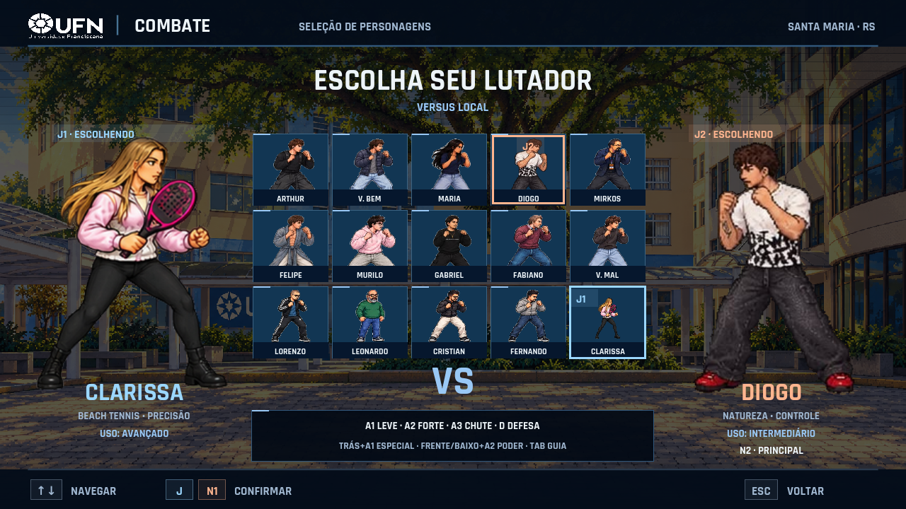

# UFN Combate — Edição Campus

**Versão 0.6.1 · Clarissa / Beach Tennis**

Nova personagem jogável, saques, chuva de bolinhas, rede, voleio, smash e Ultimate com contato confirmado. [Notas, comandos e testes da 0.6.1](docs/ATUALIZACAO-0.6.1.md). Exportação validada com Godot 4.5.1; os downloads abaixo continuam sendo da versão estável 0.6.0.



Luta 2D com personagens da comunidade, cenários inspirados na UFN e em Santa Maria, e um modo de kart 3D para até dois jogadores locais.

**Criado e desenvolvido por Diogo Liberalesso Inácio.**

Feito por Diogo Liberalesso Inácio. Para contato ou feedback, fale no Instagram [@diogok_i](https://www.instagram.com/diogok_i/) ou pelo e-mail [diogolib.inacio200@gmail.com](mailto:diogolib.inacio200@gmail.com)!

## Downloads

- **Windows x64:** [UFN-Combate-v0.6.0-Windows.zip](https://github.com/diogolibinacio200-coder/ufn-combate-0.6.0/releases/download/v0.6.0/UFN-Combate-v0.6.0-Windows.zip). Extraia e execute `UFNCombate.exe`, mantendo o `.pck` junto.
- **Código completo:** [UFN-Combate-v0.6.0-Codigo.zip](https://github.com/diogolibinacio200-coder/ufn-combate-0.6.0/releases/download/v0.6.0/UFN-Combate-v0.6.0-Codigo.zip). Abra `project.godot` no Godot 4.7.2.
- [Release, relatório e hashes](https://github.com/diogolibinacio200-coder/ufn-combate-0.6.0/releases/tag/v0.6.0).

## Atualização 0.6.0

- Diogo: pose de defesa corrigida a partir da folha original fornecida pelo autor.
- Mirkos: robôs com colisão e troca real para a skin de armadura da referência, com duração de oito segundos.
- Vitor do Bem: ativação vermelha, aproximação automática e sequência de 15 impactos confirmados por contato.
- Personagens: remoção da perda de opacidade durante mudanças de pose e da oscilação do corpo durante invulnerabilidade.
- Base 0.5.0 preservada, incluindo Arcade, Torres, Kart, tutorial, elenco, skins e controles.

[Relatório técnico](docs/ATUALIZACAO-0.6.0.md) · [Testes e limites da validação](docs/QA.md).


## Jogar no Windows

Na distribuição Windows, extraia todo o ZIP e execute **UFNCombate.exe**. Mantenha **UFNCombate.exe** e **UFNCombate.pck** juntos na mesma pasta. Não é necessário instalar o editor Godot para jogar.

A 0.6.0 evolui diretamente o repositório 0.5.0. Os controles, os modos e o formato de progresso existentes foram mantidos. Consulte [a validação desta atualização](docs/QA.md) para os testes e os detalhes do pacote. As capturas da 0.3.0 e da 0.4.0 preservadas neste README ilustram a história da base.

No menu, navegue com W/S ou as setas e confirme com Enter ou A1. Escolha o modo, os personagens e o cenário. Esc volta ou abre a pausa. F11 alterna tela cheia.

## Controles

O jogo mantém as quatro ações de ataque/defesa: **A1** (leve), **A2** (forte), **A3** (chute) e **D** (defesa). Nesta notação, D significa a ação de defesa; não significa a tecla D do teclado.

| Ação | Jogador 1 | Jogador 2 | Gamepad, padrão Xbox |
|---|---|---|---|
| Mover, pular e agachar | WASD | Setas | Direcional / analógico esquerdo |
| A1 — leve | J | Num 1 | X |
| A2 — forte | K | Num 2 | Y |
| A3 — chute | L | Num 3 | A |
| D — defesa | U | Num 4 | LB |
| Esquiva curta | Shift | Num 0 | B |
| Pausa | Esc / Enter | Esc / Enter | Start |

| Técnica | Comando |
|---|---|
| Agarrão | D + A1 |
| Ultimate, com 100 de energia | D + A2 |
| Troca em Duplas | D + A3 |
| Especial A | Trás + A1 |
| Especial ofensivo | Frente → baixo + A2 |
| Especial B | Trás + baixo + A1 |
| Especial C | Baixo → frente + A3 |
| Ascendente / rasteira forte | Cima + A2 / baixo + A2 |
| Combo básico | A1 → A1 → A1, confirmando os acertos |

Os comandos anteriores (↓, frente + A1; ↓, trás + A1; ↓, ↓ + A2) continuam válidos. A3 sozinho continua sendo chute. Frente e trás acompanham o lado do adversário, inclusive após cruzar de lado. A janela das sequências é de aproximadamente 300 ms. Segure defesa e pressione a outra ação; se várias ações chegarem juntas, a prioridade é A2, A3 e A1.

Em **Controles**, há remapeamento separado de luta e kart, seleção do dispositivo e teste das entradas. O **perfil sem numérico** usa WASD + F/G/H/R para J1 e setas + J/K/L/U para J2. Teclado, dois gamepads e combinações entre eles são aceitos pelo sistema de entrada. O funcionamento simultâneo de dois controles físicos ainda precisa de validação no hardware de destino.

A lista completa está em [GOLPES.md](GOLPES.md) e no guia acessível pela pausa ou com **Tab na seleção**.

## Modos

| Modo | Conteúdo |
|---|---|
| Arcade | Sequência de confrontos, chefes e final do personagem |
| Torre UFN | Escolha 3, 5, 8 ou 10 oponentes, em fácil/médio/difícil; André CSTH e Kelvin fecham a torre |
| Versus Local | Dois humanos ou humano contra CPU |
| Duplas 2v2 | Dois lutadores por equipe; vida e energia individuais; troca com intervalo de 5 s |
| Kart UFN | Corrida rápida, campeonato de quatro etapas e contrarrelógio |
| Treinamento | Dummy configurável, vida/energia, hitboxes, histórico e troca de oponente |
| Tutorial | Etapas de movimento, golpes, defesa, agarrão, especiais, combo, Ultimate, troca e kart |
| Torneio Local | Chave de quatro ou oito participantes humanos/CPU |
| Sobrevivência | Rivais sucessivos, recuperação de 180 HP por vitória e recorde de pontuação |

O menu também inclui **Galeria, Estatísticas, Configurações, Controles, Créditos e Sair**: 15 entradas ao todo.

As lutas normais são melhor de três, com rounds de 99 segundos; Duplas usa 150 segundos. Sobrevivência usa um round por adversário. Empates não dão vitória de round e levam a outro round. Contra chefes, o desempate por tempo compara a proporção de vida restante.

### Torre UFN

A Torre UFN usa uma escada vertical de blocos no estilo da referência enviada, redesenhada nas cores e na identidade visual da UFN. Antes de escolher o lutador, selecione **FÁCIL**, **MÉDIO** ou **DIFÍCIL** e uma torre com **3, 5, 8 ou 10 oponentes regulares**. André CSTH e Kelvin permanecem como os dois blocos finais em todas as opções. Os rivais regulares são sorteados depois da escolha do lutador, e a campanha pode ser retomada no andar salvo.

Ao derrotar Kelvin, a torre entra na animação de conquista: os blocos e retratos se soltam, caem e se espalham antes do final do campeão. A conquista é gravada antes da animação, então não há perda de progresso se a tela for fechada depois da vitória.


## Elenco e arenas

**15 jogáveis:** Diogo, Vitor do Mal, Mirkos, Fabiano, Vitor do Bem, Murilo, Felipe, Maria, Gabriel, Arthur, Leonardo, Fernando, Cristian, Lorenzo e Clarissa. **Diogo Careca** é uma skin do Diogo, com os mesmos atributos e golpes. **André CSTH e Kelvin** são os dois chefes da torre e aparecem também na galeria e como oponentes do treino.

As oito arenas são Pátio da UFN, Espaço Container, Rua de Santa Maria, Entrada da UFN, Quadra Universitária, Laboratório Tecnológico, Corredor Universitário e Vila Belga. Pátio, entrada, rua e Vila Belga usam referências locais pesquisadas. As demais são interpretações temáticas; não são reproduções documentais de instalações específicas. Veja [as referências e o mapeamento das imagens](docs/REFERENCIAS.md).


## Kart UFN

Corrida rápida e campeonato têm **oito corredores**, sendo um ou dois humanos e o restante CPU. Há três voltas, checkpoints ordenados, caixas de itens, drift com miniturbo, escudos, obstáculos e um poder exclusivo para cada um dos 14 pilotos. O contrarrelógio tem um piloto, sem CPUs nem caixas.

Pistas: **Circuito do Campus, Volta da Vila Belga, Centro de Santa Maria, Desafio Universitário e UFN / Andradas**. A nova pista pode ser escolhida na corrida rápida e no contrarrelógio. O campeonato mantém suas quatro etapas clássicas e os salvamentos existentes. A tela pode ser dividida na vertical ou horizontal.

- **A1:** acelerar; **A2:** frear e dar ré; **A3:** drift; **D:** usar item.
- **Baixo + D:** lançar para trás os itens direcionais.
- **Esquerda/direita:** virar. Aceleração automática pode ser ativada nas configurações.
- **F2:** reposicionar J1; **Backspace:** reposicionar J2. O reposicionamento preserva a ordem de checkpoints.


Os pilotos têm corpo sentado, pernas no cockpit e mãos ligadas ao volante animado. As 15 referências fornecidas orientam cabelo, rosto, roupas e cores dos 14 personagens e da skin do Diogo. Curvas, aceleração, salto e impactos inclinam o corpo. Rodas giram e esterçam; drift deixa marcas com pool limitado e rende miniturbo ao soltar na pista.

A direção usa aceleração progressiva, frenagem e resposta de curva. Colisões laterais preservam o movimento ao longo da barreira; veículos presos ou fora da pista podem ser recuperados. A câmera suaviza posição e foco, amplia discretamente o campo de visão com a velocidade e encurta a distância diante de prédios. A CPU ajusta velocidade nas curvas e procura espaço ao encontrar outros karts ou obstáculos.

**UFN / Andradas** é um circuito urbano original inspirado no entorno do Conjunto II, com fachadas, calçadas, cruzamentos, postes, árvores, placas e veículos estacionados. O traçado adapta a geografia à corrida. [Fontes, percurso e regras da pista](docs/PISTA-UFN.md).

## Configuração e progresso

Volumes geral, música, efeitos e narrador; tela cheia; 720p/1080p; qualidade padrão/leve; intensidade de tremor, flashes e partículas; legendas; texto ampliado; quatro dificuldades; aceleração automática e divisão de tela.

Configurações, controles, estatísticas, conquistas, torre, campeonato e recordes ficam em:

`%APPDATA%/Godot/app_userdata/UFN COMBATE/profile.json`

Há gravação temporária e cópia de recuperação. O jogo é local e não exige conexão durante as partidas.

## Abrir o projeto

1. Abra o editor **Godot 4.7.2 Standard**.
2. Importe `project.godot` e aguarde os recursos.
3. Use F5 para executar.

Renderer Compatibility/OpenGL; interface base de 1280 × 720; simulação a 60 Hz. Instruções de arquitetura, assets e exportação: [docs/TECHNICAL.md](docs/TECHNICAL.md).

```powershell
./tools/test.ps1 -Godot 'C:/caminho/Godot_v4.7.2-stable_win64_console.exe'
./tools/build.ps1 -Godot 'C:/caminho/Godot_v4.7.2-stable_win64_console.exe' -SignedRuntime 'C:/caminho/Godot_v4.7.2-stable_win64.exe'
```

## Histórico — atualização 0.5.0

- **Vitor do Bem:** sua Ultimate de contra-ataque mantém o gatilho original e agora usa a sequência vermelha com captura, 15 impactos e golpe final com recuo. Dano total de 280 antes da redução de combos; o vermelho é feedback temporário do alvo.
- **Vitor do Mal:** Rajada Sombria, com preparação, captura, 15 impactos e golpe final com recuo, acompanhada pela coreografia das aliadas. A sequência não aplica o feedback vermelho do Vitor do Bem.
- **Mirkos:** seis ataques de robôs, recolhimento e montagem da armadura. A sequência causa 200 de dano antes da redução de combos e preserva os oito segundos de armadura e seus bônus originais.
- **Aliada loira exclusiva:** nova arte para as invocações e os poderes de Vitor do Mal na luta e no kart. Maria continua no elenco, com sua própria arte e seus próprios poderes.
- **Animações:** caminhada ligada à distância percorrida, recuo com ciclo próprio, respiração, reação de aterrissagem e transições entre poses, incluindo Lorenzo e as duas aparências do Diogo.
- **Kart:** pilotos individualizados pelas referências, física e câmera revisadas, colisões e recuperação, CPU com antecipação de curvas e nova pista UFN / Andradas.
- **Integridade:** Diogo Careca continua sendo uma skin, com personagem, golpes, hitboxes e progresso compartilhados. Testes novos cobrem ultimates, animações, pilotos, skins e corrida.

[Notas completas da 0.5.0](docs/ATUALIZACAO-0.5.0.md) · [Validação e limites](docs/QA.md).

## Atualização 0.4.0

- Torre UFN refeita como quatro escadas verticais de blocos, com seleção independente de dificuldade e quantidade de oponentes: 3, 5, 8 ou 10 regulares, mais André CSTH e Kelvin.
- Rivais, dificuldade, skin do Diogo e próximo andar são salvos e retomáveis; registros de conclusão ficam separados por tamanho e dificuldade.
- A vitória no Kelvin dispara a desmontagem visual da torre, com blocos, retratos e poeira, e só então abre o final do campeão.
- Interface responsiva da torre validada em 1280 × 720, 1920 × 1080, 1024 × 768 e 1680 × 720.
- Nova suíte de torres com 500 verificações, capturador visual e documentação técnica.

## Atualização 0.3.0 (base)

- Quatro especiais por lutador, comandos universais relativos ao adversário, prioridade das combinações e buffer de entrada.
- Esquiva com recuperação e intervalo; combo de três leves e cancelamentos após acerto.
- Mesmos atributos básicos para os 14 jogáveis; identidade mantida nos poderes e recursos próprios. Chefes preservam suas regras.
- Ultimates de captura com duração de dois segundos, poses sincronizadas ao contato, respiração e flash de impacto.
- Animação ascendente do Diogo e efeitos ligados à mão, desenhados atrás do sprite completo nas duas skins.
- Pilotos articulados, cockpit remodelado, resposta de direção/derrapagem e câmera de kart revisadas.
- Demonstração automática no menu/seleção após oito segundos, interrompida ao interagir, sem alterar progresso.
- Tela cheia por padrão em perfis novos; HUD adaptado às bordas e fundos cobrindo a janela sem esticar personagens.

[Histórico da 0.4.0](docs/ATUALIZACAO-0.4.0.md) · [Histórico da base 0.3.0](docs/ATUALIZACAO-0.3.0.md) · [Testes, capturas e limites](docs/QA.md).

O projeto continua em desenvolvimento. As animações dos lutadores reaproveitam seus atlas e acrescentam movimento procedural e interpolação; a aliada loira tem arte própria. Os pilotos usam modelagem 3D arcade estilizada, e a pista urbana é uma interpretação jogável da região. Os resultados medidos e os limites da validação atual ficam em [QA.md](docs/QA.md). Números de FPS de versões anteriores permanecem no [registro histórico](docs/QA-v020.md) e não representam o desempenho da 0.5.0.

O projeto aproveita a base técnica de [Nexus Kombat](https://github.com/diogolibinacio200-coder/nexus-kombat), expandida para esta edição. [Créditos, procedência e licenças](LICENSES.md).
